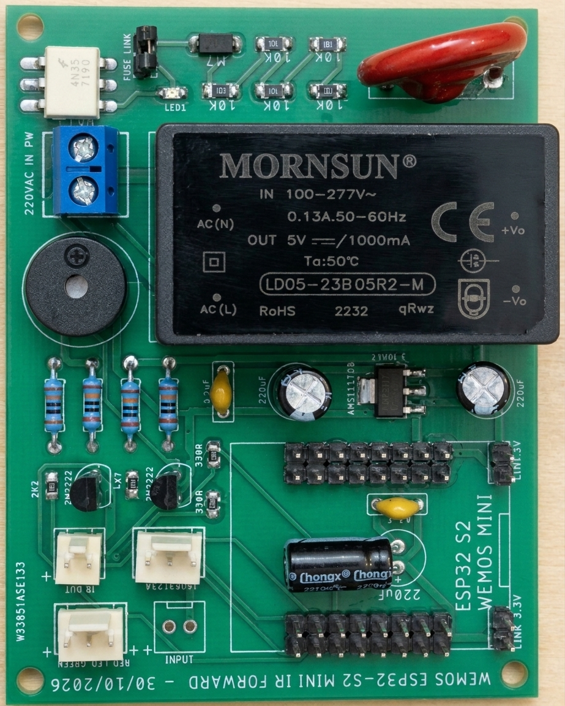
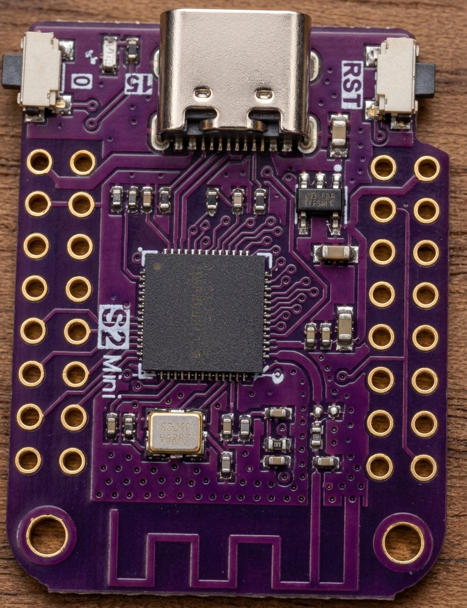
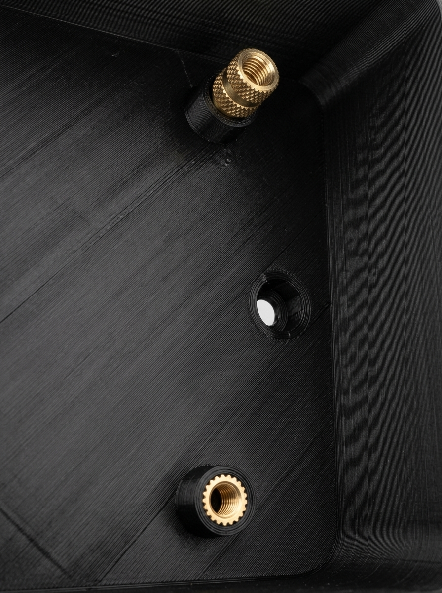

# IR Forward — DSTV remote control in another room

Use your DSTV remote in a bedroom while the decoder is in another room. A
small board in the bedroom picks up the remote's infrared signal and sends it
over WiFi (ESP-NOW, board to board) to a board at the decoder, which sends it
out again on an infrared LED in front of the decoder.

**Project page:** https://zanaz.co.za/project-irforward.html — photos, build guide,
downloads and a contact form for questions.

### Why this project: only DSTV gets through

There are many ways to carry infrared from one room to another — IR repeaters,
"remote extenders", smart IR blasters. They pass on **every** infrared signal
they see. In a house with several TVs, sound bars and air conditioners that is
a problem: the bedroom TV remote also switches the lounge TV of the same
brand, the bedroom sound bar remote changes the lounge sound bar's volume, and
so on.

**This system deliberately blocks every remote except the DSTV remote.**

- The sender decodes each infrared signal it receives. Only signals in the
  **DSTV protocol (XMP)** are passed on; everything else — TV, sound bar,
  aircon, other set-top boxes — is ignored. The LEDs show it: **green** = DSTV
  code forwarded, **red** = other remote, ignored.
- The receiver does not replay a recording of the signal: it **rebuilds the
  DSTV code with exact timing**, so the decoder gets a clean signal even when
  the bedroom reception was weak.
- Result: you can use all your remotes normally in every room, and only the
  DSTV decoder reacts to the bedroom DSTV remote.
- Not DStv? The sender can **learn another TV box's remote** instead — see
  *Another TV box*.

The only exception is on purpose and temporary: while you **record an IR
sequence** from a sender's web page, that sender also passes on other remotes,
so you can see on the receiver's side that the recorded button works.

Extras on the receiver: record **IR sequences** from any remote (TV, sound
bar, DSTV), add known codes (e.g. Samsung TV Power ON / OFF), and run them on a
**weekly schedule** — for example a daily "reset" of TV, decoder and sound bar.

| Folder | Firmware | Where the board goes |
|---|---|---|
| `TV_IR_Sending` | **Sender (TX)** — one per room with a remote | in the room, IR receiver facing the remote |
| `TV_IR_Receiving` | **Receiver (RX)** — one per decoder | at the decoder, IR LED pointed at it |
| `TV_IR_IN_ONE` | **All-in-One** — sender and receiver on one board | when the remote's room and the decoder are next to each other (IR LED wired through) |

All three run on the same PCB (`PCB/IR_FORWARD_V1`), with a WEMOS LOLIN S2 Mini
(ESP32-S2). Printable enclosure parts (.stl: case, lid, IR clip, LED holders)
are in `Enclosure/`; the PCB (schematic, board, Gerber zip) is in `PCB/`.

**Firmware on a new board in 2 minutes, from the browser** — the normal way,
no software to install: https://777bdvgp.github.io/DSTV-IR-Forward/ (Chrome or
Edge) — see step 6 below.

## Building one, step by step

### 1. Order the PCB

Upload `PCB/IR_FORWARD_V1_2026-10-04.zip` (the Gerber files) to a PCB maker
such as JLCPCB or PCBWay: 2 layers, 1.6 mm, default settings. The same PCB is
used for the sender, the receiver and the All-in-One. The Eagle schematic and
board are in `PCB/` (also as `SCHEMATIC.jpg` and `PCB.jpg`).

The finished PCB (S2 Mini not plugged in):



The **WEMOS LOLIN S2 Mini** (ESP32-S2) that plugs onto it — purple, with a
USB-C plug and the two buttons **0** (left) and **RST** (right) that you need
to put the firmware on it (step 6):



### 2. Parts on the PCB

| Qty | Part | Value / type | Silkscreen |
|---|---|---|---|
| 1 | WEMOS LOLIN **S2 Mini** (ESP32-S2) + 2 × **female** headers | plugs onto the two double pin rows | WEMOS MINI |
| 1 | AC/DC power module | **MORNSUN LD05-23B05R2-M** (100–277 V AC → 5 V) | MORNSUN |
| 1 | Voltage regulator | **AMS1117-3.3**, SOT-223 | 3.3VOLT |
| 2 | NPN transistor | **2N2222**, TO-92 | 2N2222 |
| 3 | Electrolytic capacitor | 220 µF, 16 V | C2, C3, C6 |
| 2 | Capacitor | 0.1 µF | C1, C5 |
| 4 | Resistor, through-hole | **130 Ω**, ¼ W (one per IR LED output) | U$2, U$3, U$5, U$7 |
| 1 | Resistor SMD 0805 | 2.2 kΩ | R1 |
| 2 | Resistor SMD 0805 | 330 Ω | R2, R5 |
| 1 | Resistor SMD 0805 | 4.7 kΩ | R48 |
| 1 | Screw terminal, 5.08 mm, 2-pole | mains in | 220VAC IN |
| 3 | Pin header 3-pin, 2.54 mm | TSOP, IR LEDs, red/green LED | TSOP31238, IR OUT, RED LED GREEN |
| 1 | Pin header 2-pin, 2.54 mm — **optional, may stay empty** | spare input, not used (see below) | INPUT |
| 2 | Pin header 2-pin + jumper | S2 Mini power: fit **LINK 5V**, leave **LINK 3.3V** open | LINK 5V, LINK 3.3V |

All headers are plain 2.54 mm (0.1", DuPont) — the cables use DuPont plugs.

**INPUT header — spare:** it is wired to the S2 Mini (GPIO 6, shorted to GND
= on), but no firmware uses it — nothing happens when it is switched. It is
there for a future idea; you can leave the header off the board.

**Surge protection (optional):** these parts only protect the board against
mains surges and let the firmware watch that protection. You can leave them
all out — the buzzer too, because it is only used to tell you that the
surge protection (TMOV) has blown:

| Qty | Part | Value / type | Silkscreen |
|---|---|---|---|
| 1 | Thermal MOV | **Littelfuse TMOV20RP275E** | LITLE_FUSE |
| 1 | Optocoupler | **4N35**, DIP-6 | OK1 |
| 1 | Diode | **M7** (1N4007), SMD | M7 |
| 1 | LED SMD 0805 | | LED1 |
| 5 | Resistor SMD 1206 | 10 kΩ | R10–R14 |
| 1 | Pin header 2-pin + jumper | jumper fitted (off = test "blown") | FUSE_LINK |
| 1 | Buzzer | **active** buzzer, **5 V**, 12 mm — only sounds when the TMOV has blown | BUZZER |

Left them out? Untick **Surge protection parts fitted (TMOV, 4N35)** on the
board's *Settings* page once after the first setup. The status then shows
*not fitted* and the buzzer stays quiet. Until you do, the board reports the
surge protection as **BLOWN** and the buzzer beeps every 2 seconds. With the
parts fitted, the board checks them all the time: a blown TMOV gives that
alarm (status **BLOWN**, buzzer beeps). Meanwhile you can switch the buzzer
off with the tick box **Mute buzzer - MOV blown** on the *Settings* page
until the TMOV is replaced.

**110–120 V countries (USA, Canada, Japan …):** the MORNSUN module works on
100–277 V, 50 or 60 Hz, so it stays the same — the "220VAC" on the PCB is only
printing. Two surge protection parts are made for 230 V:

- **TMOV:** use the 120 V version **Littelfuse TMOV20RP140E** (same size and
  footprint). The 275 V one is safe on 120 V but hardly protects.
- **4N35 monitor** (5 × 10 kΩ): on 120 V the 4N35 gets about half the current.
  It should still see the mains pulses — not tested. If the status shows
  **BLOWN** with a good TMOV, use 5 × 4.7 kΩ instead.

Or leave the surge protection out and untick *Surge protection parts fitted*.

### 3. Parts on cables (off the PCB)

| Part | Sender | Receiver | All-in-One | Connects to |
|---|:-:|:-:|:-:|---|
| **TSOP31238** IR receiver (38 kHz) | yes | optional (to record sequences on the receiver itself) | yes | TSOP31238 |
| **IR LED** 940 nm, e.g. TSAL6200 — 1 to 4 | — | yes | yes | IR OUT |
| **Red** and **green** 5 mm LED | yes | optional | yes | RED LED GREEN |
| Mains cable with plug | yes | yes | yes | 220VAC IN |

The red / green LEDs show what happens to each IR signal: on a sender
**green** = DSTV code forwarded, **red** = other remote, ignored.

### 4. Enclosure

3D-printable parts are in `Enclosure/` (.stl), printed in **PLA**. Pick the
case for how the board will be placed:

| Board | Print | Placement |
|---|---|---|
| Sender, box visible | `Case.stl` + `IR_Clip.stl` | the IR receiver (TSOP) is clipped on the inside of the box, at the side |
| Sender, box hidden | `Case2.stl` + `RoomLEDHolder.stl` | the box is hidden; the IR receiver and the red / green LEDs sit in the holder, mounted in the frame of the TV stand |
| Receiver | `Case3.stl` | hidden (e.g. in the roof), with wires out to **2 IR LEDs** pointed at the DSTV decoder |

Extra parts in the folder: `Lid`, `Angle`, `RoomLEDSupr`.

**Fixing the PCB in the case.** Two ways, use whichever you have:

- **Brass inserts (optional):** press threaded brass heat-set inserts into
  the posts in the case with a hot soldering iron, then screw the PCB down
  onto them from the inside.
- **No inserts?** Use ordinary **countersunk screws from the bottom**: put
  each screw in from under the case, through the countersunk hole, so its
  head sits flush with the bottom, and use it to hold the PCB down in the case.



### 5. Assembly

1. Solder the SMD parts first (resistors, AMS1117, and the optional M7 /
   LED1 / 10 kΩ), then the low through-hole parts, then the tall ones
   (capacitors, buzzer, terminal, MORNSUN, TMOV).
2. Mind the polarity of the electrolytic capacitors, the 2N2222s, the 4N35
   (pin 1 dot), the buzzer (+) and the diode.
3. Solder the female headers to the **S2 Mini**, so it plugs onto the PCB and
   can be taken off.
4. Fit the **LINK 5V** jumper (not LINK 3.3V), and FUSE_LINK if the surge
   parts are fitted.
5. Make the cables for the TSOP, the IR LED(s) and the red / green LEDs with
   2.54 mm DuPont plugs.
6. **Before connecting mains:** flash the firmware over USB (next section) —
   the S2 Mini gets its power from USB then. Program it **off** the board or
   with the mains disconnected.

**Safety:** the PCB carries mains voltage (230 V or 120 V). Never touch the board while it is
connected to mains, and always fit it in its closed enclosure. Have the mains
wiring checked by a qualified person.

### 6. Put the firmware on the S2 Mini

**The normal way is A, the Install page in the browser** — nothing to
install, and it takes about 2 minutes. Use B only if you are a developer who
wants to change the code.

| | **A. In the browser** | **B. With PlatformIO** |
|---|---|---|
| For | everyone who just wants it running | developers who want to change the code |
| You need | Chrome or Edge on a PC / Mac | VS Code + PlatformIO, about 1 GB of tools |
| Time | about 2 minutes | about 20 minutes the first time |

Both need a **USB-C data cable** (some cables only charge). Flash the S2 Mini
**off the PCB**, or with the mains disconnected — it gets its power from USB.
The buttons **0** and **RST** are at the top, left and right of the USB-C plug
(see the S2 Mini photo in step 1).

#### A. In the browser — the normal way (no software to install)

1. Open the **Install page** of this project in **Chrome** or **Edge**
   — **https://777bdvgp.github.io/DSTV-IR-Forward/** (the page is `docs/index.html`).
2. Plug in the S2 Mini. Hold button **0**, tap **RST**, let go of **0**.
3. Click **Sender**, **Receiver** or **All-in-One**, pick the port in the
   pop-up (often `ESP32-S2`), then **Install**. Answer **Erase** with yes for a
   new board. It takes about a minute.
4. Tap **RST**. The board starts its setup WiFi — go on with *First setup*.
   (If the page says it cannot connect after the install: normal — the S2
   Mini cannot restart itself over USB; the firmware is written.)

Without the Install page: download `sender.bin`, `receiver.bin` or
`allinone.bin` from `docs/firmware/` and flash it with the
[Espressif web flasher](https://espressif.github.io/esptool-js/) — *Connect*,
**Flash Address `0x0`**, choose the file, *Program*.

#### B. With PlatformIO (only for developers)

1. Install [Visual Studio Code](https://code.visualstudio.com), then in VS
   Code *Extensions* → **PlatformIO IDE**.
2. Download this project (*Code → Download ZIP*, or `git clone`) and unzip it.
3. *File → Open Folder* → the folder of the firmware you want, e.g.
   `TV_IR_Receiving` (that folder itself, not the top folder). The first build
   downloads the ESP32 tools and libraries by itself (a few minutes).
4. Plug in the S2 Mini, hold button **0**, tap **RST** (download mode).
5. Flash over USB:
   - Sender: `pio run -e usb -t upload`
   - Receiver: `pio run -e rx_usb -t upload`
   - All-in-One: `pio run -e usb -t upload`
6. Press **RST**. (The upload may report "failed" only because the S2 cannot
   be reset over USB — the firmware is written.)

Every build also writes two files to the project's `firmware_out/`:
`<project>_v<version>.bin` (updates over WiFi) and `<project>_v<version>_full.bin`
(a whole new board, flashed at address `0x0` — what the Install page uses).
To refresh the Install page after a new version: build the three projects,
run `python docs/update_firmware.py`, commit `docs/`. Built with your own
`src/Private.h`, the file is named `..._full_PRIVATE.bin` and the script
leaves it out — never share that one.

## First setup (once per board)

A new board has no WiFi settings. It opens its own **setup WiFi**:
`IR-FORWARD-TX-xxxx`, `IR-FORWARD-RX-xxxx` or `IR-FORWARD-IN1-xxxx` (open, no
password). The red and green LEDs blink alternately.

1. Join that WiFi with a phone. The setup page opens (or go to `http://192.168.4.1`).
2. Pick your home WiFi, enter its password.
3. IP address: tick **automatic (DHCP)**, or enter a fixed IP.
4. **Channel lock** — see *WiFi channel* below. In short:
   - **receiver**: **Any channel** (one router or a mesh system)
   - **sender**: **Follow receiver** (already selected on a new sender)
5. **Choose an owner password** (6+ characters) and keep it safe. You need it
   to change the WiFi settings later and for every firmware update.
6. Save. The board restarts and joins your WiFi.

The setup WiFi comes back by itself if the board cannot connect 3 times in a
row (and leaves again after 5 minutes to retry), or when you hold button **0**
for 5 seconds (WiFi settings deleted). Saving there always needs the owner
password, so a neighbour joining the setup WiFi cannot change anything.

### How to open the board's page

| Address | When |
|---|---|
| `http://192.168.4.1` | **Only during setup**: your phone must be connected to the board's own setup WiFi `IR-FORWARD-…`. It stops working once the board has joined your home WiFi. |
| `http://192.168.1.xxx` (the board's IP) | **Normal use**, on your home WiFi. Works on every phone and PC. Find the IP in your router's list of connected devices. |
| `http://<host name>.local` | **Normal use** too, e.g. `http://ir-tx-9e80.local`. The host name is `ir-` + `tx` / `rx` / `in1` + the last 4 characters of the setup WiFi name (you can change it on the setup page). Works on PCs and iPhones; many Android phones do not support `.local`, so use the IP there. |

If you only see the setup page at `192.168.4.1` while you expected your home
WiFi, the board could not join it — usually a typo in the WiFi password. Set
it up again and watch out for the phone's automatic capital first letter.

## WiFi channel

The senders talk to the receiver directly over the air (ESP-NOW), not through
your router. That only works when they are all on the **same WiFi channel**.
The **receiver** decides the channel; senders set to **Follow receiver** find
it by themselves.

| Your WiFi | Receiver: Channel lock | Senders: Channel lock |
|---|---|---|
| One router | Any channel | Follow receiver |
| Mesh system (TP-Link Deco, Google / Nest WiFi, Eero …) | Any channel | Follow receiver |
| Several separate access points on different channels | Any channel, or a fixed channel (see *Several access points*) | Follow receiver |

**How "Follow receiver" works:** the sender remembers the channel on which it
hears the receiver, also after a restart. If it hears nothing from the
receiver for 5 minutes (for example because the router changed channel), it
leaves the WiFi for about 30 seconds, listens on channels 1 to 13 for the
receiver, and restarts on the channel where it found it. If the receiver is
not found (switched off?), it waits longer before the next try — 10, 20, 40,
up to 80 minutes — and goes back to its normal WiFi meanwhile.

The All-in-One has no channel setting: it does not use ESP-NOW.

## Using it

Open the board's IP (or `http://<host name>.local`) in a browser.

- **Sender**: status, link to the receiver, settings, and **IR SEQUENCES** —
  record a sequence by pointing a remote at this board.
- **Receiver**: status of all senders, **IR SEQUENCES** (run, edit, add known
  codes such as Samsung TV Power ON/OFF) and **SCHEDULE** (run sequences at set
  times; per line: on/off, × repeats, every … ms, pause after).
- **All-in-One**: status, **IR SEQUENCES** with the schedule (as on the
  receiver; record by pointing a remote at this board) and **SETTINGS**
  (forwarding on/off, *Forward remote* / *Learn remote*, *Echo guard*).
- **WIFI** page on every board. Sender and receiver also have `/wifiscan`:
  which access points the board hears, on which channel and how strong.

### All-in-One: Echo guard

The All-in-One receives the remote on its IR eye and sends it out again on its
IR LED. If the eye can **see its own IR LED** (same room, or a reflection off
a wall or window), it picks up its own signal and sends it again — the decoder
gets every button two or more times. The **Echo guard** (Settings) stops that:
it ignores everything the eye receives while the LED sends and for 150 ms
after.

| Where is the IR LED? | Echo guard |
|---|---|
| In another room, or the eye cannot see it | **off** (default) |
| The eye can see the LED | **on** |

Leave it off when you can: held buttons (volume, scrolling channels) send a
repeat every ~80 ms, and with the guard on those repeats are thrown away.

Test: press one DStv button once and watch the green LED — **one** flash is
right; several flashes for one press means an echo → switch the guard on.

## Another TV box (not DStv)

Out of the box only the DStv remote is forwarded. For another TV box —
Sky, Foxtel, a cable or satellite box, a Freeview box … — teach the sender
(or the All-in-One) that box's remote:

1. Open the board's **Settings** page.
2. Tick **Learn remote**, press **UPDATE**.
3. Point the TV box's remote at the board and press one button (shortly).
4. **Forward remote** now shows that remote, e.g. `NEC 0x20DF`, and
   *Learn remote* is unticked again. From now on only that remote is
   forwarded — green LED; every other remote is ignored — red LED.

Back to DStv: type `XMP` in **Forward remote** and press **UPDATE**. You can
also type a remote yourself: a protocol name (`NEC`, `SAMSUNG`, `RC5`, `RC6`,
`SONY`, `PANASONIC`, …), optionally followed by the address of that remote.

Good to know:
- A DStv code is rebuilt with exact timing. Other remotes are passed on as the
  timing the board received — that works for most remotes, but test it.
- Remotes with very long codes (more than 100 pulses) cannot be forwarded,
  and remotes that use Bluetooth or radio instead of infrared (e.g. Sky Q,
  Apple TV) cannot be used at all.
- With several senders, teach each sender the same remote.

## Firmware updates over WiFi

The owner password protects network updates. Set it once on your PC as the
environment variable `IR_OTA_PASS`, e.g. on Windows:

```
setx IR_OTA_PASS your-owner-password
```

(open a new terminal afterwards), then:

```
pio run -e ota -t upload --upload-port <board ip>        (sender, All-in-One)
pio run -e rx_ota -t upload --upload-port <board ip>     (receiver)
```

Own upload targets: copy `private.example.ini` to `private.ini` (not committed)
and add `[env:...]` sections with your boards' IPs.

All-in-One without PlatformIO: build, then upload
`firmware_out/TV_IR_IN_ONE_v<version>.bin` on `http://<board ip>/update`.

Forgot the owner password? Erase the board over USB
(`pio run -e usb -t erase`, receiver: `-e rx_usb`) and flash again; then do
the first setup again.

## Several access points

With several access points on different channels, each board joins the one it
hears best — possibly on different channels. "Follow receiver" keeps the
senders with the receiver, but each sender also needs an access point **on
the receiver's channel** for its own WiFi (web page, updates). So choose the
receiver's channel with care:

1. Fix the 2.4 GHz channel of your access points (not *Auto*), so it does not
   change by itself.
2. Open `/wifiscan` on every board (WIFI page → *Which access points does this
   board hear?*) and pick the channel that **every** board hears well (better
   than about -70 dBm). Several access points on that one channel are fine.
3. Receiver: set **Channel lock** to that channel. Senders: **Follow receiver**
   (or the same channel number).
4. If your WiFi system can lock clients to access points (e.g. TP-Link Omada
   "Lock to wireless device"), allow only the access points on that channel —
   **after** step 3, otherwise the boards lose WiFi until they restart.

## Troubleshooting

- **A sender shows *offline* on the receiver's status page**, although it is
  powered and its own web page opens: it is on a different WiFi channel than
  the receiver. With *Follow receiver* it searches by itself within 5 minutes
  (its log says "searching channels 1-13" and "Receiver found on channel …").
  With a fixed channel: check the Channel lock of both boards, and `/wifiscan`.
- **A sender's web page does not open after it followed the receiver:** there
  is no access point on the receiver's channel that this sender can hear — see
  *Several access points*.
- **The red and green LEDs blink alternately:** the board is in its setup WiFi
  (it could not join your WiFi 3 times). It retries your WiFi after 5 minutes;
  to change the settings, join `IR-FORWARD-…` with a phone.
- **"Authentication Failed" on a network upload:** `IR_OTA_PASS` is not set,
  or not to this board's owner password. Open a new terminal after `setx`.

## Optional: `src/Private.h`

Building several boards for yourself? Copy `src/Private.example.h` to
`src/Private.h` (never committed) to pre-load the owner password, your access
point names and (All-in-One) your WiFi networks into every board you flash.

## Licence

Copyright (c) 2026 Bennie Vermeulen. Licensed under
[CC BY-NC 4.0](https://creativecommons.org/licenses/by-nc/4.0/): you may use,
share and change it for **non-commercial** purposes, with credit to the author.
Selling the firmware, boards, enclosures or devices built from them is not
allowed. See `LICENSE`.

**Safety:** the board runs from mains voltage (230 V or 120 V). Building and installing it is at
your own risk — have mains wiring done or checked by a qualified person.
